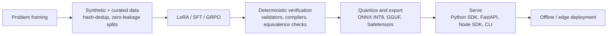

<!-- Banner -->

  

  

  
  
  
  
  

---

## 👋 About

I'm an **AI/ML Engineer (Entrepreneur-in-Residence) at [NeoGeoInfo Technologies](https://neogeoinfo.com)**. I design and ship end-to-end intelligent systems: multimodal geospatial fusion pipelines, real-time fleet telemetry, and small, fast models that run offline on a single consumer GPU or a CPU.

| | |
|---|---|
| 🔭 **Building now** | OptiFleet (IoT telemetry) · Multimodal Geospatial Fusion · edge LLM inference · privacy-first Indic NLP |
| 🌱 **Going deeper on** | Agentic AI · MLOps · Geospatial Intelligence · efficient inference |
| 💡 **Open to** | Geospatial AI · Autonomous Systems · Production ML |
| ⚙️ **Default stance** | Verify the model's output with deterministic checks, and publish the numbers, including the unflattering ones |

---

## 🧭 How I Build

- **Verify, don't trust.** Models sit inside deterministic guardrails: Verhoeff and Luhn checksums, `jsonschema` validation, sandboxed `gcc -Wall -Wextra -Werror` builds, token-level equivalence tests.
- **Leakage-free evaluation.** Hash-based dedup and split-leakage audits before any number gets reported.
- **Small and local by default.** Quantized ONNX/GGUF artifacts, under 3 GB of VRAM, CPU fallbacks, no runtime network calls.
- **Shipped, not demoed.** SDKs, REST APIs, CLIs, test suites, and reproducible reports in every repo.

---

## 🚀 Featured Projects

### ⚡ Efficient &amp; Edge LLMs

<table>
<tr>
<td width="50%" valign="top">
<h4><a href="https://github.com/adityapande403/SpecDecode-edge">SpecDecode Edge</a></h4>

Research and deployment framework for <b>speculative decoding</b> on a single GPU. Trains Medusa-style draft heads on a frozen Qwen2.5-1.5B target and verifies that output stays token-for-token identical to standard decoding.

<code>PyTorch</code> · <code>Medusa heads</code> · <code>KV-cache rollback</code> · <code>vLLM/Safetensors export</code> · <a href="https://huggingface.co/Adityapande403/SpecDecode-edge">🤗 Model</a>
</td>
<td width="50%" valign="top">
<h4><a href="https://github.com/adityapande403/Embeddie-coder">EmbeddedCoder AI</a></h4>

Offline-first small language model for <b>embedded systems engineering</b>: firmware, RTOS, and hardware triage. Paired with deterministic Modbus / J1939 / OBD-II / AIS-140 decoders, sandboxed GCC checks, and local BM25 datasheet retrieval.

<code>Qwen2.5-Coder</code> · <code>LoRA SFT</code> · <code>BM25 RAG</code> · <code>FastAPI</code> · <a href="https://huggingface.co/Adityapande403/embeddie-coder">🤗 Model</a>
</td>
</tr>
<tr>
<td width="50%" valign="top">
<h4><a href="https://github.com/adityapande403/Universal-JSON-Extractor">Universal JSON Extractor</a></h4>

Schema-guided extraction that turns noisy text (OCR, logs, tickets, scraped HTML) into <b>strictly validated JSON</b>. Prompt-injection isolation, bounded repair, and an abstention policy that refuses to invent missing fields.

<code>Qwen2.5-1.5B</code> · <code>PEFT / DPO / GRPO</code> · <code>Ollama / GGUF</code> · <code>FastAPI</code> · <a href="https://huggingface.co/Adityapande403/universal-json-extractor">🤗 Model</a>
</td>
<td width="50%" valign="top">
<h4><a href="https://github.com/adityapande403/VisDoc-AI">VisDoc AI</a></h4>

<b>Visual document retrieval</b> with ColQwen2.5 and late-interaction MaxSim scoring. Searches datasheets, schematics, invoices and balance sheets straight from page images, with no OCR and no text chunking.

<code>ColQwen2.5</code> · <code>MaxSim</code> · <code>INT8 / 1-bit index</code> · <code>PyMuPDF</code> · <code>FastAPI</code> · <a href="https://huggingface.co/Adityapande403/VisDoc-AI">🤗 Model</a>
</td>
</tr>
</table>

### 🛡️ Privacy-First Indic NLP

<table>
<tr>
<td width="50%" valign="top">
<h4><a href="https://github.com/adityapande403/Loc-shield-AI">LocalShield AI</a></h4>

Offline <b>PII detection and redaction</b> before data reaches an external LLM or log pipeline. Hybrid engine: checksum validators (Aadhaar, cards, PAN, IFSC) plus a multilingual DistilBERT tagger for English, Hindi and Hinglish. Four redaction modes and optional encrypted, reversible pseudonymization.

<code>DistilBERT</code> · <code>ONNX INT8</code> · <code>FastAPI</code> · <code>Node.js SDK</code> · <a href="https://huggingface.co/Adityapande403/LocShield-AI">🤗 Model</a>
</td>
<td width="50%" valign="top">
<h4><a href="https://github.com/adityapande403/Indic-mix-AI">IndicMix AI</a></h4>

Language understanding for <b>code-mixed Indian text</b> (Hinglish, Telgish, Benglish and native scripts): intent, moderation, PII redaction, and entity-preserving normalization as three independently trainable model families.

<code>ONNX Runtime</code> · <code>Python + Node.js</code> · <code>FastAPI</code> · <code>edge-ready</code> · <a href="https://huggingface.co/Adityapande403/IndicMix-AI">🤗 Model</a>
</td>
</tr>
</table>

### 🌍 Geospatial, IoT &amp; Computer Vision

<table>
<tr>
<td width="33%" valign="top">
<h4><a href="https://neogeoinfo.com/solutions/optifleet.html">OptiFleet</a></h4>

Real-time IoT fleet platform: low-latency GPS telemetry, route optimization, fuel-efficiency analytics, and vision-based driver monitoring.

<code>IoT</code> · <code>telemetry</code> · <code>CV</code>
</td>
<td width="33%" valign="top">
<h4><a href="https://github.com/adityapande403/multimodal-geospatial-fusion">Multimodal Geospatial Fusion</a></h4>

Deep-learning pipeline fusing satellite imagery, LiDAR, GPR and GNSS. Attention-based multi-scale fusion delivered a <b>20% gain in spatial alignment accuracy</b>, evaluated with RMSE and SSIM.

<code>PyTorch</code> · <code>LiDAR</code> · <code>GPR</code> · <code>GNSS</code>
</td>
<td width="33%" valign="top">
<h4><a href="https://github.com/adityapande403/cv_3d_detect">3D-Print Defect Detection</a></h4>

YOLOv5 real-time defect detection for FFF/FDM printers: <b>&gt;90% detection accuracy</b>, deployed on a Raspberry Pi via TensorFlow Lite / ONNX.

<code>YOLOv5</code> · <code>TFLite</code> · <code>Raspberry Pi</code>
</td>
</tr>
</table>

---

## 📏 Measured, Not Claimed

Every figure below comes from a report or README in the linked repo. The context column says what it was measured on.

| Project | Result | Context |
|---|---|---|
| **SpecDecode Edge** | Token-identical output in 6 of 8 workload categories · **1.08×** on code generation · **2.96 GB** peak VRAM | Frozen Qwen2.5-1.5B, RTX 5060 Ti 16 GB; the other 2 categories diverged only at exact bf16 logit ties |
| **VisDoc AI** | **253 ms → 10.7 ms** at 1,000 pages (23.7×) via two-stage pruning · INT8 index **2×** smaller with no NDCG@5 loss · 1-bit index **16×** smaller | Held-out set plus a 10,000-page scale benchmark |
| **Universal JSON Extractor** | **98%** JSON parse · **86%** schema compliance · **0%** hallucinated fields | 50 held-out samples, 1 epoch of LoRA SFT on 27k synthetic examples |
| **LocalShield AI** | **128.9 MB** INT8 ONNX · **3.95 ms** P50 end-to-end (2.27 ms raw model) · 38 tests passing | CPU-only, full detect-and-redact pipeline |
| **IndicMix AI** | **222 KB** INT8 ONNX · **0.69 ms** P50 full pipeline · 60 tests passing | Windows 11, Intel CPU |
| **EmbeddedCoder AI** | **~2.9 GB** VRAM · **56–60 tok/s** · 20/20 tests passing | i7-14700K + RTX 5060 Ti |

---

## 🛠️ Tech Stack

**Languages** 

**ML, LLMs &amp; Computer Vision** 

**Backend, MLOps &amp; Edge** 

**Specialized domains:** Geospatial AI (LiDAR · Satellite · GPR · GNSS) · IoT telemetry · Speculative decoding &amp; quantization · Retrieval (late interaction) · LangChain &amp; agentic systems

---

## 📊 GitHub Activity

  
  
  

---

## 📫 Let's Connect

I'm happy to talk about geospatial AI, efficient inference, or shipping ML that has to work offline.

- **Email:** [adityapande403@gmail.com](mailto:adityapande403@gmail.com)
- **LinkedIn:** [linkedin.com/in/aditya-pande](https://linkedin.com/in/aditya-pande)
- **Hugging Face:** [huggingface.co/Adityapande403](https://huggingface.co/Adityapande403)
- **Résumé:** [Download PDF](https://github.com/adityapande403/adityapande403/blob/main/Aditya_Pande_Resume.pdf)

  

<i>Always learning, building, and shipping.</i>

